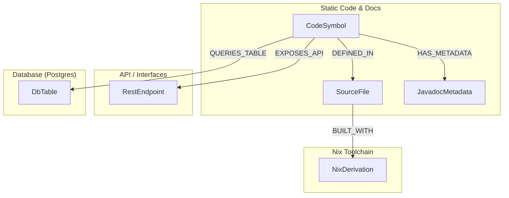

# 📐 Unified System Knowledge Graph (USKG) — Architektur & Daten-Plan

Dieses Dokument beschreibt den detaillierten Plan für das **Agentic Graph-Driven Development (AGDD)** im B2C Contract Checker Projekt. Es bündelt statische Code-Strukturen, API-Schnittstellen (OpenAPI), Javadoc-Metadaten und relationale Datenbankstrukturen (PostgreSQL/RLS) in einem glasklaren SurrealDB-Wissensgraphen.

---

## 🔍 Ist-Analyse: OpenAPI & Swagger im aktuellen Projekt

1.  **FastAPI AI-Gateway (`03_b2c-ai-gateway`):**
    *   **Status:** FastAPI hat native OpenAPI-Generierung eingebaut, diese ist jedoch in `main.py` aus Sicherheitsgründen hart deaktiviert (`docs_url=None`, `openapi_url=None`).
    *   **Potenzial:** Für die Entwicklung (Dev-Modus) ist OpenAPI extrem wertvoll. Aktivieren wir es im Dev-Modus, liefert uns FastAPI unter `/openapi.json` ein perfektes JSON-Schema aller Endpunkte (`/api/v1/analyze`, `/api/v1/chat`), inklusive ihrer Pydantic-Request/Response-Modelle (`AnalyzeRequest`, `ChatRequest`).
2.  **Spring Boot Backend (`02_b2c-contractchecker-spring`):**
    *   **Status:** Aktuell ist **kein OpenAPI/Swagger** in `pom.xml` deklariert.
    *   **Potenzial:** Durch Hinzufügen des standardmäßigen `springdoc-openapi-starter-webmvc-ui` (Springdoc) generiert Spring Boot vollautomatisch unter `/v3/api-docs` ein OpenAPI-Schema aller Controller (Web-Views & REST-Schnittstellen).

### 💡 Warum OpenAPI im Wissensgraphen extrem Sinn macht:
Anstatt dass ein KI-Agent oder Entwickler mühsam durch den Quellcode scrollen muss, um zu verstehen, wie eine Schnittstelle aufgerufen wird, liest der Agent einfach das **OpenAPI-Schnittstellen-Objekt** direkt aus SurrealDB. Er sieht sofort:
*   Welche HTTP-Methode wird erwartet?
*   Wie muss das JSON-Datenpaket (Pydantic / DTO) aufgebaut sein?
*   Welche Sicherheitsrollen sind nötig?

---

## 🗺️ Der Daten-Plan: Was wird wo gespeichert und wie hängt es zusammen?

Um ein sauberes Wissensnetzwerk ohne Rauschen ("Zero Noise") aufzubauen, teilen wir den Graphen in **6 klare Kernelemente** auf.

---

## 💾 Detailliertes Knoten- & Kanten-Modell (SurrealDB)

### 1. Die Knoten (Nodes)

#### `SourceFile` (Quellcode-Dateien)
*   **Zweck:** Repräsentiert physische Dateien im Repo.
*   **Properties:** `path` (relativ), `language` (Java, Python, Nix).

#### `CodeSymbol` (Klassen, Interfaces, Methoden, Funktionen)
*   **Zweck:** Beschreibt die eigentliche Programmierstruktur.
*   **Properties:** `name`, `type` (class/method), `lines` (range), `doc_summary`.

#### `JavadocMetadata` / `DocNode` (Semantischer Kontext)
*   **Zweck:** Speichert Beschreibungen, um dem LLM die Intention hinter dem Code zu erklären.
*   **Properties:** `description` (Embedding-fähig), `params` (Array), `returns`, `exceptions` (Array), `security_rules` (z.B. `@security Forced Admin Bypass`).

#### `RestEndpoint` (API-Schnittstellen)
*   **Zweck:** Beschreibt unsere REST- und Web-Routing-Punkte (aus OpenAPI generiert).
*   **Properties:** `method` (GET/POST), `path`, `auth_required` (true/false), `request_schema` (JSON), `response_schema` (JSON).

#### `DbTable` (PostgreSQL Datenbank-Schema)
*   **Zweck:** Beschreibt die Tabellen, Spalten und RLS-Richtlinien aus Postgres.
*   **Properties:** `name`, `rls_enabled` (true/false), `rls_policy_sql` (SQL String), `columns` (JSON-Map der Spalten und Typen).

#### `NixDerivation` (Bauanweisungen)
*   **Zweck:** Ermöglicht die Rückverfolgbarkeit von Systemabhängigkeiten.
*   **Properties:** `name`, `version`.

---

### 2. Die Beziehungen (Relations/Edges)

*   `CodeSymbol -[defined_in]-> SourceFile`: Wo ist diese Klasse/Methode definiert?
*   `CodeSymbol -[calls]-> CodeSymbol`: Welche Methode ruft welche andere Methode auf (Call-Hierarchy).
*   `CodeSymbol -[has_metadata]-> JavadocMetadata`: Welche Dokumentation gehört zu dieser Klasse/Methode?
*   `CodeSymbol -[exposes_api]-> RestEndpoint`: Welcher Java-Controller oder FastAPI-Endpunkt bedient diese HTTP-Route?
*   `CodeSymbol -[queries_table]-> DbTable`: Welche Datenbanktabelle wird von diesem Code (z.B. JPA Repository) gelesen oder geschrieben?
*   `SourceFile -[built_with]-> NixDerivation`: Welches Nix-Paket wird zum Bauen/Ausführen dieser Codedatei benötigt?

---

## 🛠️ Operationalisierungs-Plan (Schritt-für-Schritt)

### Schritt 1: Wiping & Tabellen-Bereinigung (Clean Slate)
Damit keine Altlasten oder Datenleichen in SurrealDB verbleiben, bereinigt die Go-CLI bei jedem `b2c graph sync` die alten Strukturen.
Wir führen ein robustes `REMOVE` aller Tabellen am Anfang der Transaktion aus, bevor wir die frischen Schemadefinitionen laden.

### Schritt 2: OpenAPI in Spring Boot aktivieren
Wir fügen `springdoc-openapi-starter-webmvc-ui` in die `pom.xml` des Spring Boot Backends ein, sodass uns dort im Dev-Modus vollautomatische Schnittstellen-Spezifikationen zur Verfügung stehen.

### Schritt 3: OpenAPI in FastAPI aktivieren (Dev-Modus)
Wir passen `main.py` im FastAPI AI-Gateway an, sodass OpenAPI und Swagger-Docs geladen werden, wenn die Umgebung als `dev` deklariert ist.

### Schritt 4: Erweiterung des Go-Syncers (`b2c graph sync`)
Die Synchronisierungs-Engine in Go wird so erweitert, dass sie:
1.  Die Tabellen vorab leert.
2.  Die Nix-Flakes parst.
3.  Die Java- und Python-ASTs liest, Klassen, Methoden, Javadocs und `@security`-Tags extrahiert.
4.  Controller-Klassen scannt und sie als `RestEndpoint`-Knoten anlegt.
5.  Flyway-Migrationsdateien (`src/main/resources/db/migration/`) liest, um die Postgres-Tabellendefinitionen (`DbTable`) und RLS-Policies zu parsen und im Graphen zu verknüpfen.

---

### 🚀 Bereit zur Umsetzung?
Als Nächsten Schritt werden wir:
1.  **Die OpenAPI-Dependency im Spring Boot-Backend ergänzen** und FastAPI für Dev-OpenAPI anpassen.
2.  **Den Go-Sync-Parser in der CLI so anpassen**, dass er alte Daten löscht, die neuen Tabellen (`RestEndpoint`, `DbTable`) definiert und mit maximaler Klarheit verknüpft!
