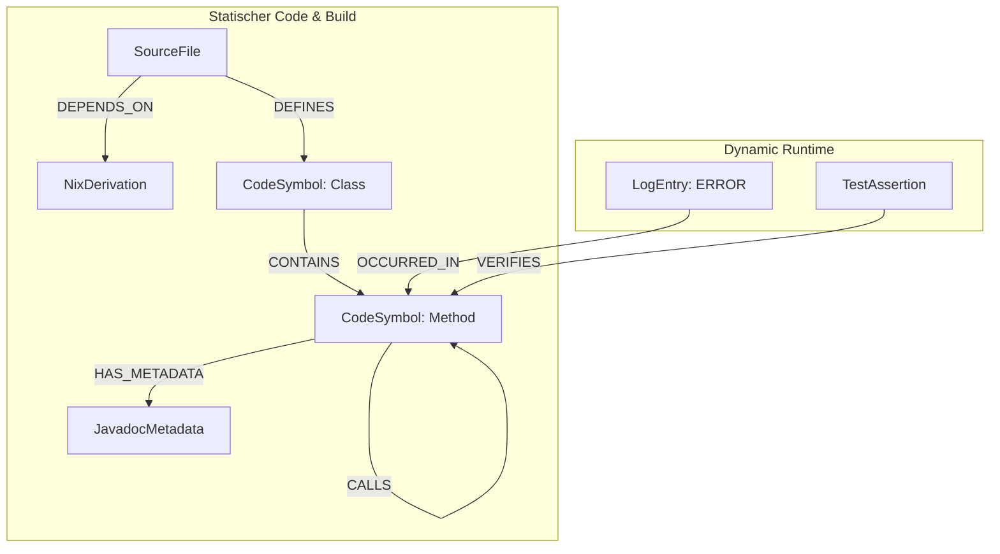

# 🧠 Agentic Graph-Driven Development (AGDD) mit SurrealDB & Nix
## Roadmap & Technische Dokumentation für das B2C Contract Checker System

Dieses Dokument beschreibt die Architektur, das Datenmodell und die Implementierungs-Roadmap für die Integration von **SurrealDB** als zentraler Graph- und Knowledge-Datenbank. Ziel ist es, das gesamte Monorepo (Nix-Abhängigkeiten, Quellcode-AST, Javadoc-Metadaten und strukturierte Live-Logs) so zu vernetzen, dass KI-Agenten und Entwickler das System in Sekundenschnelle präzise analysieren, debuggen und erweitern können.

---

## 🗺️ Die Roadmap: Inkrementelle Integration

```
Phase 1: Fundament (Nix & DB) ──> Phase 2: Static Sync Engine (AST/Javadoc) ──> Phase 3: Dynamic Sync (Logs) ──> Phase 4: Agentic Interface (LLM)
```

### 🗓️ Phase 1: Lokales Fundament & Datenbank-Bootstrapping (Woche 1)
*   **Ziel:** SurrealDB nativ in die lokale Entwickler-Umgebung bringen, ohne Docker-Zwang für die DB selbst.
*   **Meilensteine:**
    *   [ ] **Nix-Integration:** Hinzufügen von `surrealdb` zur `devShell` in `flake.nix`.
    *   [ ] **CLI-Erweiterung:** Implementierung von `b2c db start` und `b2c db stop` in der Go-CLI (`tools/b2c-cli/main.go`), um eine leichtgewichtige, lokale SurrealDB-Instanz im Hintergrund zu verwalten.
    *   [ ] **Schema-Definition:** Erstellen der initialen SurrealQL-Migrationsskripte für das Graph-Schema (`SourceFile`, `CodeSymbol`, `NixDerivation` etc.).

### 🗓️ Phase 2: Static Sync Engine (AST- & Javadoc-Parser) (Woche 2-3)
*   **Ziel:** Den statischen Quellcode und seine Abhängigkeiten automatisiert in den Graph laden.
*   **Meilensteine:**
    *   [ ] **Nix-Parser:** Ein Skript/Go-Befehl parst die Ausgabe von `nix path-info --json` und verknüpft Nix-Pakete als Knoten im Graph.
    *   [ ] **AST- & Javadoc-Extraktor:**
        *   Für **Java (`02_b2c-contractchecker-spring`)**: Nutzung eines schlanken AST-Parsers (z. B. `javaparser` oder Tree-Sitter) zur Extraktion von Klassen, Methoden, `@see` / `@link` Verweisen und Javadoc-Kommentaren.
        *   Für **Python (`03_b2c-ai-gateway`)**: Nutzung des Python AST-Moduls zur Extraktion von Funktionen, Klassen und Docstrings.
    *   [ ] **Vektorisierung (Embeddings):** Generierung von Vektoren für alle Javadoc-Beschreibungen, Funktionserklärungen und Markdown-Docs, um semantische Suchen direkt in SurrealDB zu ermöglichen.
    *   [ ] **Verknüpfung:** Automatisches Erzeugen von Kanten:
        *   `CodeSymbol -[:CALLS]-> CodeSymbol` (Aufrufhierarchie)
        *   `CodeSymbol -[:DEFINED_IN]-> SourceFile`

### 🗓️ Phase 3: Dynamic Sync (Log- & Test-Pipeline) (Woche 4)
*   **Ziel:** Echtzeit-Runtime-Daten mit dem statischen Code-Graphen verheiraten.
*   **Meilensteine:**
    *   [ ] **Strukturiertes Logging:**
        *   Konfiguration des Logbacks in Spring Boot auf **JSON-Format** mit MDC-Feldern (Mapped Diagnostic Context) wie `tenant_id`, `user_id` und `trace_id`.
        *   Konfiguration von FastAPI Loguru auf identische JSON-Strukturen.
    *   [ ] **Log-Streaming:** Ein kleiner Hintergrund-Daemon liest die Logs und schreibt sie direkt in SurrealDB als `LogEntry`-Knoten.
    *   [ ] **Log-to-Code Linker:** Automatisches Verknüpfen von Fehlermeldungen/Stacktraces mit den betroffenen `CodeSymbol`-Knoten über Kanten vom Typ `[OCCURRED_IN]`.
    *   [ ] **Test-Logger:** Webhook-Integration für `pytest` und JUnit, um fehlgeschlagene Test-Assertions direkt als fehlerhafte Kanten im Graph zu markieren.

### 🗓️ Phase 4: Agentic Skill & LLM Interface (Woche 5)
*   **Ziel:** Die Datenbank als mächtiges Werkzeug für KI-Agenten nutzbar machen.
*   **Meilensteine:**
    *   [ ] **SurrealDB MCP-Server:** Bereitstellung eines Model Context Protocol (MCP) Servers für VS Code Copilot, der es dem LLM erlaubt, den Graphen über SurrealQL und Vektorsuche direkt abzufragen.
    *   [ ] **Automatisierte Diagnostics:** Erkennt ein Agent einen Fehler im Code, fragt er zuerst den Fehler-Knoten und dessen Nachbarknoten ab, um die genaue Ursache (z. B. RLS-Bypass fehlgeschlagen) zu isolieren.

---

## 🏛️ Architektur des Graphen

Dieses Diagramm zeigt, wie die Datenpunkte aus Entwicklung, Bauprozess und Betrieb in SurrealDB miteinander verwoben werden:



---

## 💾 SurrealDB Schema-Definition (SurrealQL)

Folgendes Schema beschreibt die Tabellen und Beziehungen. SurrealDB ist schemalos oder schema-forced – wir nutzen hier ein teils-definiertes (schema-full) Modell für maximale Typsicherheit.

```surrealql
-- ==========================================
-- 1. KNOTEN (TABLES)
-- ==========================================

-- SourceFile: Physische Dateien im Repo
DEFINE TABLE SourceFile SCHEMAFULL;
DEFINE FIELD path ON TABLE SourceFile TYPE string;
DEFINE FIELD language ON TABLE SourceFile TYPE string;
DEFINE FIELD hash ON TABLE SourceFile TYPE string;

-- CodeSymbol: Klassen, Interfaces und Methoden
DEFINE TABLE CodeSymbol SCHEMAFULL;
DEFINE FIELD name ON TABLE CodeSymbol TYPE string;
DEFINE FIELD type ON TABLE CodeSymbol TYPE string; -- "class" | "interface" | "method" | "function"
DEFINE FIELD start_line ON TABLE CodeSymbol TYPE int;
DEFINE FIELD end_line ON TABLE CodeSymbol TYPE int;

-- JavadocMetadata: Dokumentation & Verträge am Code
DEFINE TABLE JavadocMetadata SCHEMAFULL;
DEFINE FIELD description ON TABLE JavadocMetadata TYPE string;
DEFINE FIELD params ON TABLE JavadocMetadata TYPE array;
DEFINE FIELD throws ON TABLE JavadocMetadata TYPE array;
DEFINE FIELD security_rules ON TABLE JavadocMetadata TYPE array; -- z.B. ["Forced RLS"]
-- Vektor-Index für semantische Textsuche direkt im Javadoc
DEFINE INDEX javadoc_vector ON TABLE JavadocMetadata FIELDS description MTREE DIMENSION 1536 DISTANCE cosine;

-- NixDerivation: Build-Spezifikationen von Nix
DEFINE TABLE NixDerivation SCHEMAFULL;
DEFINE FIELD name ON TABLE NixDerivation TYPE string;
DEFINE FIELD version ON TABLE NixDerivation TYPE string;
DEFINE FIELD drv_path ON TABLE NixDerivation TYPE string;

-- LogEntry: Echtzeit-Logs
DEFINE TABLE LogEntry SCHEMAFULL;
DEFINE FIELD timestamp ON TABLE LogEntry TYPE datetime;
DEFINE FIELD level ON TABLE LogEntry TYPE string; -- "INFO" | "WARN" | "ERROR"
DEFINE FIELD message ON TABLE LogEntry TYPE string;
DEFINE FIELD trace_id ON TABLE LogEntry TYPE option<string>;
DEFINE FIELD stack_trace ON TABLE LogEntry TYPE option<string>;
-- Vektor-Index für Log-Mustererkennung
DEFINE INDEX log_vector ON TABLE LogEntry FIELDS message MTREE DIMENSION 1536 DISTANCE cosine;


-- ==========================================
-- 2. BEZIEHUNGEN (EDGES)
-- ==========================================

-- Kante von CodeSymbol zu SourceFile
DEFINE TABLE defined_in SCHEMAFULL TYPE RELATION FROM CodeSymbol TO SourceFile;

-- Kante für Aufrufhierarchien (Methodenaufrufe)
DEFINE TABLE calls SCHEMAFULL TYPE RELATION FROM CodeSymbol TO CodeSymbol;

-- Kante für Javadoc-Referenzen (@see, @link)
DEFINE TABLE references_symbol SCHEMAFULL TYPE RELATION FROM JavadocMetadata TO CodeSymbol;

-- Kante für Nix-Abhängigkeiten
DEFINE TABLE built_with SCHEMAFULL TYPE RELATION FROM SourceFile TO NixDerivation;

-- Kante für Log-Zuordnung
DEFINE TABLE occurred_in SCHEMAFULL TYPE RELATION FROM LogEntry TO CodeSymbol;
```

---

## 🛠️ Praxisbeispiele: Wie KI-Agenten den Graphen abfragen

Hier sind drei konkrete SurrealQL-Abfragen, die ein KI-Agent ausführen kann, um komplexe Probleme sofort zu erfassen:

### Fall 1: Fehlerursache bei RLS-Bypass finden
*   **Problem:** Ein Administrator meldet, dass im Ops Control Center keine Metriken mehr geladen werden. Im Log taucht ein `ERROR` auf.
*   **Abfrage des Agenten:**
    ```surrealql
    -- Finde den Fehler, die Klasse und die Sicherheitsvorgaben aus dem Javadoc auf einen Schlag
    SELECT 
        message, 
        ->occurred_in->CodeSymbol.name AS method_name,
        ->occurred_in->CodeSymbol->defined_in->SourceFile.path AS file_path,
        ->occurred_in->CodeSymbol->defined_in->SourceFile->defined_in->JavadocMetadata.security_rules AS security
    FROM LogEntry 
    WHERE level = 'ERROR' AND message CONTAINS 'bypass_rls'
    LIMIT 1;
    ```
*   **Ergebnis:** Der Agent sieht sofort: *"Die Methode `getOpsMetrics` in `OpsMetricsController.java` hat eine Exception geworfen. Laut Javadoc ist dafür das Security-Tag `@security Forced Admin RLS Bypass` definiert, aber der Header `X-Ops-Secret` fehlte im Request."*

### Fall 2: Impact-Analyse vor einem Nix-Dependency-Update
*   **Szenario:** Der Entwickler möchte die Python-Version oder das Paket `uv` in der `flake.nix` aktualisieren und wissen, welche Codedateien davon direkt betroffen sein könnten.
*   **Abfrage des Agenten:**
    ```surrealql
    SELECT path, language 
    FROM SourceFile 
    WHERE ->built_with->(NixDerivation WHERE name = 'uv');
    ```

### Fall 3: Semantische "Finde-die-richtige-Methode"-Suche (Graph-RAG)
*   **Szenario:** Der Agent soll ein Feature programmieren, das Verträge validiert, weiß aber nicht, wo das im Code definiert ist.
*   **Abfrage des Agenten (Semantische Suche + Graph-Verknüpfung):**
    ```surrealql
    -- Suche im Javadoc nach der Absicht und finde die zugehörige Code-Klasse
    LET $vector = [0.012, -0.043, ...]; -- Embedding von "vertrag validieren und analysieren"
    
    SELECT 
        description,
        <-has_metadata<-CodeSymbol.name AS method_name,
        <-has_metadata<-CodeSymbol->defined_in->SourceFile.path AS file_path
    FROM JavadocMetadata 
    WHERE description VECTOR_SEARCH $vector, 1536, "cosine"
    LIMIT 1;
    ```

---

## 🚀 Fazit & Next Steps

Dieses AGDD-System transformiert die Softwareentwicklung von einem textbasierten Suchspiel in ein **hochpräzises Graph-Navigations-System**. Es vereinfacht das Coding mit Maschinen radikal, da es der KI erlaubt, den gesamten Kontext des Projekts (Code, Build-Spezifikationen und Live-Zustand) mit minimalen Abfragen perfekt zu überschauen.

**Nächster Schritt:** Wir fügen SurrealDB zu unserer `flake.nix` hinzu, um das lokale Fundament (Phase 1) zu legen!
