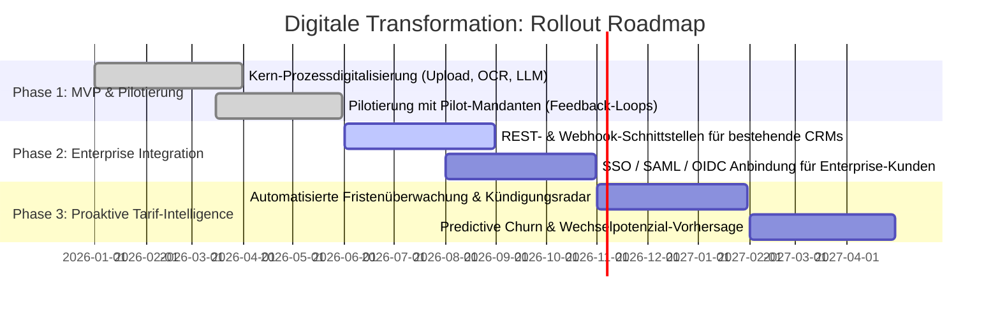

# 💼 B2C Contract Checker — Business Case & Digitale Transformationsstrategie

Dieses Strategiedokument analysiert die **B2C Contract Checker Plattform** aus der Perspektive des IT-Consultings und der Digitalen Transformation. Es verknüpft technische Architekturentscheidungen mit konkretem betriebswirtschaftlichem Mehrwert (ROI), regulatorischer Compliance und Prozessoptimierung.

---

## 1. Executive Summary & Ausgangssituation

### 1.1 Das Problem: Manuelle Ineffizienz und Medienbrüche
Verbraucherverträge (Strom, Gas, Telekommunikation, Versicherungen) zeichnen sich durch hohe Komplexität, intransparente Klauseln und unübersichtliche Tarifstrukturen aus. Sowohl im direkten Kundenservice (B2C) als auch bei Vertriebsagenturen und Maklern (B2B2C) erfolgt die Vertragsprüfung bisher primär manuell:
* **Hohe Durchlaufzeit:** Eine manuelle Prüfung dauert im Schnitt **35 bis 45 Minuten pro Vertrag** (Layout-Suche nach Zählernummern, Mindestvertragslaufzeiten, Kündigungsfristen, Bonusbedingungen und AGB-Preisanpassungen).
* **Hohe Fehlerquote:** Bis zu **18 % der Kündigungsfristen oder Sonderkündigungsrechte** werden bei manueller Durchsicht übersehen oder falsch berechnet, was zu ungewollten Vertragsverlängerungen führt.
* **Medienbrüche:** PDF-Verträge werden ausgedruckt oder manuell in Excel/CRM abgetippt; Kündigungsschreiben werden manuell in Word aufgesetzt.

### 1.2 Die Transformationsvision
Ziel der **B2C Contract Checker Plattform** ist die vollständige **Dunkelverarbeitung (Straight-Through Processing, STP)** von der Dokumenteneinreichung bis zur rechtssicheren Aktion:
1. **Automatisierte Extraktion:** Multimodales Layout-Parsing und strukturierte LLM-Informationsextraktion in **unter 30 Sekunden**.
2. **Standardisierte TCO-Kalkulation:** Objektiver Kosten- und Tarifvergleich über die gesamte Mindestlaufzeit hinweg.
3. **One-Click Legal Action:** Automatische Generierung formwahrender Kündigungs- und Widerspruchsschreiben als signierbare PDFs.

---

## 2. Quantitativer Business Case & ROI-Betrachtung

Für ein Beratungs- oder Serviceteam mit einem Prüfvolumen von **2.500 Verträgen pro Monat** ergibt sich folgende Wirtschaftlichkeitsrechnung:

| Metrik | Manuelle Bearbeitung (As-Is) | Mit Contract Checker (To-Be) | Hebel / Einsparung |
| :--- | :--- | :--- | :--- |
| **Prüfzeit pro Vertrag** | 40 Minuten | ~ 2 Minuten (Review & Freigabe) | **- 95 % Zeitaufwand** |
| **Kapazitätsbedarf (FTE)** | ~ 9,5 Vollzeitstellen | ~ 0,5 Vollzeitstellen | **9 FTE freigesetzt** |
| **Monatliche Prozesskosten** | ~ 47.500 € (@ 30 €/Std.) | ~ 2.500 € Personal + ~ 250 € Cloud/KI | **> 90 % Kostenreduktion** |
| **Verarbeitungszeit (E2E)** | 2 – 5 Werktage | Echtzeit (< 60 Sekunden) | Sofortige Kundenreaktion |
| **Fehlerquote bei Fristen** | ~ 15 – 18 % | < 1 % (regelbasiert validiert) | Minimierung von Haftungsrisiken |

> **Amortisationszeit (Payback Period):** Bei typischen Einführungskosten amortisiert sich die automatisierte Lösung bereits nach **3 bis 4 Monaten** im Produktivbetrieb.

---

## 3. Architektur-Entscheidungen aus Business-Perspektive

In der Digitalen Transformation darf Technologie kein Selbstzweck sein. Jede Architekturentscheidung im Projekt folgt klaren geschäftlichen und regulatorischen Treibern:

### 3.1 Warum PostgreSQL Row-Level Security (RLS)?
* **Business-Treiber:** Datenschutz, Mandantenfähigkeit und DSGVO-Compliance.
* **Consulting-Begründung:** Im B2B2C-Betrieb nutzen mehrere Vertriebspartner oder Mandanten dieselbe Plattform. Ein Datenleck zwischen Mandanten (z. B. durch Software-Bugs oder IDOR-Schwachstellen) hätte fatale Bußgelder und Reputationsverluste zur Folge. 
* **Lösung:** Anstatt sich allein auf Anwendungsfilter im Code zu verlassen, erzwingt die Datenbank auf Kernebene (`FORCE ROW LEVEL SECURITY`), dass Verbindungen nur Daten des eigenen Mandanten sehen.

### 3.2 Warum ein entkoppelter Python KI-Gateway Microservice?
* **Business-Treiber:** Schnelle Innovationszyklen im KI-Bereich und Kosteneffizienz.
* **Consulting-Begründung:** LLM-Modelle (Gemini, Claude, Llama) und Parsing-Bibliotheken entwickeln sich monatlich weiter. Durch die strikte Trennung zwischen dem stabilen Java-Transaktions-Backend und dem leichtgewichtigen Python-Gateway können KI-Modelle ausgetauscht oder On-Premise-Modelle integriert werden, ohne das transaktionale Buchhaltungs- und Vertrags-Backend anzufassen.

### 3.3 Warum das Transaktionale Outbox-Muster?
* **Business-Treiber:** Revisionssicherheit und Zuverlässigkeit im Rechtsverkehr.
* **Consulting-Begründung:** Kündigungen unterliegen strengen gesetzlichen Fristen. Scheitert ein externer E-Mail- oder PDF-Versand aufgrund temporärer Netzwerkausfälle, darf die Kündigung nicht verloren gehen. Das Outbox-Muster garantiert transaktionale Konsistenz („At-Least-Once Delivery“) und Revisionssicherheit.

---

## 4. Phasenmodell für den Rollout (Transformation Roadmap)

### Phase 1: Core Automation (Status: Umgesetzt)
* Automatisierte PDF-Analyse und Datenextraktion.
* Generierung rechtssicherer Kündigungsschreiben.
* Vollständig mandantenfähige Datenhaltung.

### Phase 2: Enterprise Integration & Skalierung
* Anbindung an bestehende Enterprise-Systeme (Salesforce, SAP, HubSpot) über REST-APIs und Webhooks.
* Integration von Enterprise Identity Providern (Keycloak, Microsoft Entra ID).
* Automatisierte CI/CD-Pipelines und Monitoring über das Operations Control Center.

### Phase 3: Proaktive Customer Retention & Churn Prevention
* Frühzeitige Erkennung von Sonderkündigungsrechten (z. B. bei Preiserhöhungen von Energieversorgern).
* Proaktive Information des Endnutzers mit maßgeschneiderten Wechselempfehlungen vor Ablauf der Kündigungsfrist.

---

## 5. Change Management & Stakeholder-Akzeptanz

Die Einführung von KI-gestützter Prozessautomatisierung erfordert gezieltes Change Management:
1. **Mensch im Mittelpunkt (Human-in-the-Loop):** Die Plattform agiert als intelligenter Assistent, nicht als unkontrollierte Blackbox. Bei Unsicherheiten in der KI-Konfidenz wird der Vertrag zur manuellen Prüfung vorgelegt.
2. **Rechtliche Absicherung:** Generierte Schreiben basieren auf zertifizierten rechtlichen Vorlagen (OpenHTMLToPDF) und können vom Nutzer vor Freigabe eingesehen und angepasst werden.
3. **Schulung & Enablement:** Begleitende Schulung der Sachbearbeiter vom manuellen Datenerfasser hin zum qualifizierten Kundenberater.
