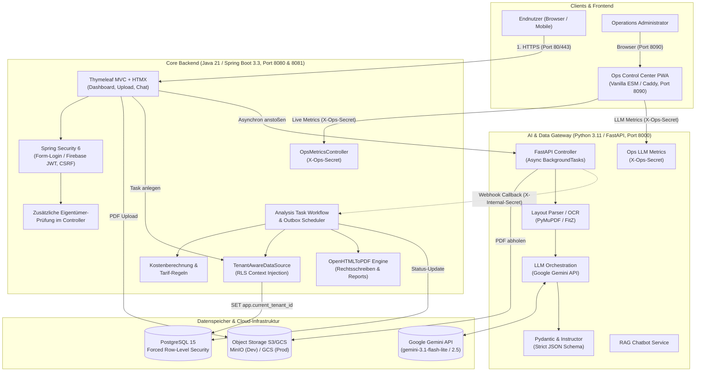

# B2C Contract Checker — Systemarchitektur

Dieses Dokument beschreibt die ganzheitliche Systemarchitektur der **B2C Contract Checker** Plattform (`01_b2c_module`). Es dient Entwicklern, Architekten und Ops-Teams als Referenz für Komponenten, Datenflüsse, Schnittstellen und Sicherheitsgrenzen.

---

## 1. Systemübersicht & Architekturdiagramm

Die Plattform basiert auf einer service-orientierten Monorepo-Architektur, die robuste Unternehmensstandards (Spring Boot 3, PostgreSQL RLS) mit leichtgewichtigen KI-Pipelines (FastAPI, PyMuPDF, Google Gemini) und einem isolierten Administrations-Cockpit (Ops Control Center) kombiniert.



---

## 2. Modulübersicht & Verantwortlichkeiten

| Verzeichnis | Technologie | Hauptfunktion |
| :--- | :--- | :--- |
| **`02_b2c-contractchecker-spring`** | Java 21, Spring Boot 3.3.x, Thymeleaf, HTMX, Spring Data JPA, Flyway, OpenHTMLToPDF | Hauptanwendung für B2C-Kunden: Registrierung, Vertrags-Upload, Dashboard, Tarifvergleich, Kündigungs-/Widerspruchsschreiben, RLS-Mandantentrennung, Outbox-Worker. |
| **`03_b2c-ai-gateway`** | Python 3.11+, FastAPI, Astral `uv`, PyMuPDF, Google Gemini, `instructor`, Pydantic | Asynchrone Dokumentenextraktion, OCR-Fallback, strukturierte JSON-Extraktion mittels LLM, RAG-Chatbot-Backend. |
| **`04_ops-control-center`** | Vanilla Web Components (ESM), PWA Service Worker, Tailwind CSS, Caddy | Isoliertes Administrations- und Überwachungs-Cockpit für Systemgesundheit, Pipeline-Status, Token-Kosten und Mandanten-Statistiken. |
| **`helm/b2c-platform`** | Helm 3, Kubernetes (GKE) | Produktionsreife Manifeste für GKE mit HPA, Ingress, Cert-Manager, NetworkPolicies und PodDisruptionBudgets. |
| **`setup-base/`** | Bash, Google Cloud CLI (`gcloud`) | Infrastruktur-Bootstrap: Workload Identity Federation (WIF), Artifact Registry, GCS-Buckets und Secrets. |
| **`devlocal`** | POSIX Bash Skript | Zentrales CLI-Werkzeug für Onboarding (`setup`), Tool-Prüfung (`doctor`), lokale Ausführung (`start`) und automatisierte Tests (`test`). |

---

## 3. Datenfluss: Vertragsanalyse & Weiterverarbeitung

1. **Vertrags-Upload**:
   * Der Nutzer lädt eine PDF-Vertragsdatei im Browser hoch (`POST /contract/upload`).
   * Spring Boot speichert die Datei verschlüsselt im Object Storage (lokal: MinIO `b2c-contracts`; Produktion: GCS).
   * Ein Eintrag in `analysis_tasks` mit Status `PENDING` wird in PostgreSQL angelegt.
2. **Asynchrone Pipeline-Delegation**:
   * Spring Boot ruft `POST http://aigateway:8000/api/v1/analyze` mit `task_id`, `s3_url`, `callback_url` und `tenant_id` auf.
   * FastAPI nimmt den Auftrag sofort mit HTTP 202 (`accepted`) an und startet die Analyse über `BackgroundTasks`.
3. **KI-Extraktion**:
   * PyMuPDF extrahiert Text, Tabellen und Strukturdaten aus dem Dokument.
   * Google Gemini wird über die `instructor`-Bibliothek mit striktem Pydantic-Schema aufgerufen (Vertragspartner, Laufzeiten, Kündigungsfristen, Grundpreis, Arbeitspreis, Boni).
4. **Sicherer Callback**:
   * FastAPI sendet das validierte JSON-Ergebnis an `POST /api/v1/webhook/ai-callback` des Spring Boot Backends.
   * Der Callback wird über den Header `X-Internal-Secret` kryptografisch validiert.
5. **Kostenberechnung & Tarifprüfung**:
   * Spring Boot aktualisiert den Task-Status auf `COMPLETED`, speichert das JSON in `analysis_tasks.summary` (`jsonb`) und berechnet die monatlichen und jährlichen Gesamtkosten sowie mögliche Ersparnisse.
6. **Kündigungsschreiben & Aufgaben-Warteschlange**:
   * Bei Bedarf generiert der Nutzer Kündigungsschreiben oder Widersprüche (`POST /contract/{id}/legal-action`).
   * Ein Eintrag wird in der Tabelle `legal_actions` angelegt (Outbox-Muster).
   * Der asynchrone `LegalActionOutboxWorker` holt offene Aktionen ab, generiert ein PDF via OpenHTMLToPDF und versendet dieses per E-Mail an den Anbieter.

---

## 4. Mandantentrennung & Mehrstufiges Sicherheitskonzept

Das System sichert Kundendaten auf mehreren Ebenen ab:

1. **Ebene 1: PostgreSQL Row-Level Security (RLS)**:
   * Alle Mandantentabellen (`contracts`, `analysis_tasks`, `chunks`, `legal_actions`, `users`) erzwingen RLS (`FORCE ROW LEVEL SECURITY`).
   * `TenantAwareDataSource` injiziert bei jeder Verbindung aus dem Verbindungspool (HikariCP) die Session-Variablen:
     ```sql
     SET app.current_tenant_id = '<uuid>';
     SET app.current_user_id = '<uuid>';
     ```
2. **Ebene 2: Objektbezogene Autorisierung (IDOR-Prävention)**:
   * Da B2C-Endnutzer einem gemeinsamen Standard-Mandanten angehören, validiert jeder Controller über `verifyContractOwner`:
     ```java
     if (!contract.getUser().getId().equals(userDetails.getUserId())) {
         throw new AccessDeniedException("Zugriff verweigert: Vertrag gehört einem anderen Benutzer.");
     }
     ```
3. **Ebene 3: Transaktionale Outbox & Kontrollierter RLS-Bypass**:
   * Hintergrund-Worker (`LegalActionOutboxWorker`) und Monitoring-Controller (`OpsMetricsController`) nutzen ein strikt gekapseltes `try-finally`-Muster für systemweite Abfragen:
     ```java
     TenantContext.setBypassRls(true);
     try {
         // Systemweite Aktionen verarbeiten...
     } finally {
         TenantContext.clear();
     }
     ```
4. **Ebene 4: Web- & Schnittstellensicherheit**:
   * **CSRF**: Spring Security 6 mit `CookieCsrfTokenRepository.withHttpOnlyFalse()` und automatischer HTMX-Integration.
   * **M2M-Sicherheit**: Interner Callback-Endpunkt mit `X-Internal-Secret`, Ops-Dashboard-Endpunkte mit `X-Ops-Secret`.
   * **Static Assets**: Whitelist für statische Ressourcen unter `/assets/**` und `/images/**`.

---

## 5. Ports & Netzwerk-Grenzwerte

| Komponente | Interner Port | Externer Port (Dev / Prod) | Zugriff / Schutz |
| :--- | :--- | :--- | :--- |
| **Spring Boot Web App** | `8080` | `8080` (Dev) / `443` (Prod Ingress) | Öffentlich (mit Spring Security) |
| **Spring Boot Actuator** | `8081` | Nicht über öffentlichen Ingress | Nur internes Monitoring (Prometheus/K8s) |
| **FastAPI AI-Gateway** | `8000` | `8000` (Dev) / Cluster-intern | Nur M2M via `X-Internal-Secret` |
| **Ops Control Center (Caddy)** | `8090` | `8090` (Dev) / IAP-gesichert | Nur Administratoren (Google IAP / MFA) |
| **PostgreSQL** | `5432` | `5434` (Dev) / Cluster-intern | DB-Nutzer mit RLS-Einschränkungen |
| **MinIO S3 API / Console** | `9000` / `9001` | `9000` / `9001` (Dev) / GCS in Prod | S3-kompatible Schnittstelle |
